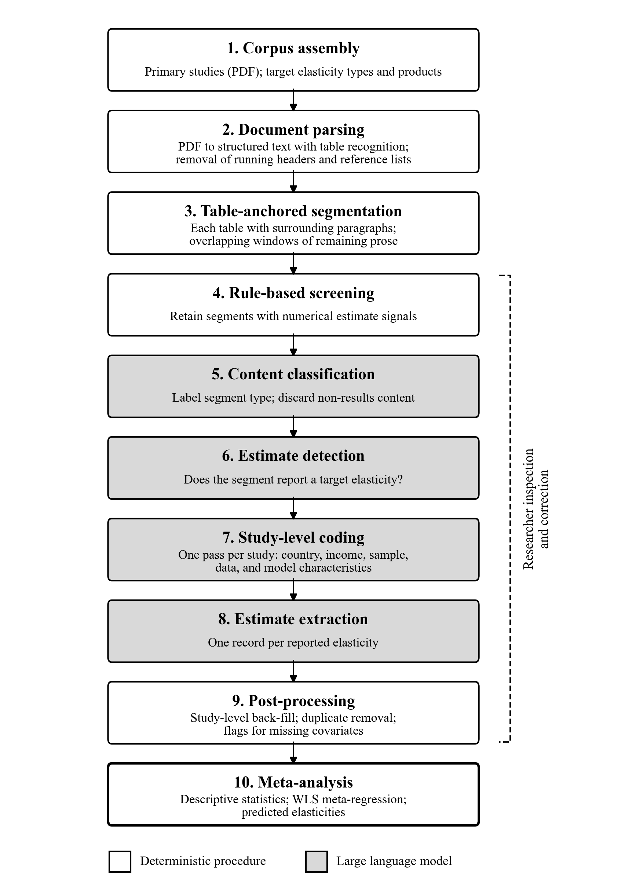

# Data Collection and Coding

## Overview of the extraction procedure

Elasticity estimates and study characteristics were collected with a semi-automated pipeline that combines deterministic text processing, large language models (LLMs), and researcher verification (Figure 1). The pipeline takes as input the full texts of the primary studies and a list of target quantities, namely the elasticity types of interest (income, own-price, and cross-price elasticities of demand) and the products to which they refer. Its output is a coded dataset with one observation per reported elasticity, which serves as the basis for the meta-analysis described in the next section.

The procedure has four phases: document processing, multi-stage screening, coding of estimates and study characteristics, and quality control. Screening proceeds from inexpensive rule-based checks to LLM judgments, so that the more capable and more costly model is applied only to passages that are likely to contain a target estimate. Each phase writes its intermediate output to disk, and the researcher inspected and, where necessary, corrected the output of every phase from rule-based screening onward before proceeding to the next.

*Figure 1. Workflow for extracting elasticity estimates from primary studies. Shaded steps use a large language model; unshaded steps are deterministic. The bracket marks the steps whose output was inspected and, where necessary, corrected by the researcher.*

## Document processing

Each study was converted from PDF to structured text with [Marker / pdfplumber]. Marker applies layout-detection, optical character recognition, and table-recognition models; pdfplumber identifies tables geometrically from character positions and ruling lines. In both cases, tables are preserved as row-and-column structures rather than flattened into running text. Running headers and footers (journal citation lines, copyright notices, page numbers) and the reference list were removed before further processing, while appendices were retained because they frequently report additional estimates. The abstract of each study was extracted separately and retained as context for the later coding steps.

The processed text was then divided into segments. Because the meaning of a coefficient in a regression table depends on its column headers, notes, and the authors' interpretation, each table was kept intact as a single segment together with the two paragraphs immediately preceding and following it. Tables that the parser rendered as sequences of isolated values rather than as a grid were identified from runs of short coefficient and standard-error lines and treated in the same manner. The remaining text was divided into windows of approximately 1,800 characters that respect paragraph boundaries and overlap by approximately 200 characters, so that estimates reported only in the text are not split across segments.

## Screening

Segments passed through three successive filters. First, a rule-based screen retained a segment if it contained at least one of the following: a decimal number in parentheses (typically a standard error or *t*-statistic), significance markers accompanying decimal numbers, a decimal number together with an estimation-related term (for example, "coefficient", "elasticity", "standard error", or "confidence interval"), or a table. The abstract was exempt from this screen. Second, a lower-cost LLM ([model name and version]) assigned each retained segment to one or more content categories (regression table, results text, methodology, data description, literature review, or other) and indicated whether the segment should be kept; segments it marked for exclusion, such as summaries of earlier literature, were discarded. Third, the same model judged whether each remaining segment reported a point estimate of one of the target elasticity types for one of the target products. Only segments with a positive judgment proceeded to coding.

At each screening stage, the researcher reviewed the retained and excluded segments for every study and could reverse any decision.

## Coding of estimates and study characteristics

Coding was performed by a more capable LLM ([model name and version]) in two passes. In the first pass, the model coded study-level characteristics once per study, using the abstract and the segments classified as methodology or data description (truncated to 12,000 characters). These characteristics are country or region, sample period, data frequency, number of observations and cross-sectional units, data source, real per capita income, level of aggregation, geographic scope, urban–rural coverage, data structure, price measure, conditional or unconditional specification, number of budgeting stages, demand system, estimation method, inclusion of demographic controls, publication status, language, and the number of goods in the demand system.

In the second pass, the model coded each screened segment, given the segment text, the study abstract, and the list of target quantities. For every reported estimate that matched a target, it returned the elasticity type, the product and, for cross-price elasticities, the second product whose price changed, the wording used in the study, the point estimate and its measure of precision, the functional form of the estimated relationship, and the estimate's location in the table. Each product was additionally mapped to one of the nine product groups of Chen et al. (2016): grains and vegetables, meat and eggs, edible oil, aquatic products, fruits, sugar, dairy, tobacco, and alcohol. Where a segment did not state a study-level characteristic itself, the value from the first pass was used; values reported in the segment, such as the sample size of a robustness check, took precedence.

The full prompts used at each LLM step are reported in [Appendix X].

## Quality control

Three checks were applied to the coded estimates. First, when the same estimate was recorded twice from the same study, once with full precision and once rounded (for example, from a table and from the accompanying text), the rounded duplicate was removed. Second, estimates for which real per capita income or the budget share was not reported, or, for conditional elasticities, the group expenditure or group own-price elasticity was not reported, were left missing and flagged for review; no values were imputed. Third, the researcher reviewed the coded dataset against the source documents and corrected, added, or removed estimates where necessary.

The pipeline records the functional form of each estimate but does not convert between functional forms. Likewise, conditional elasticities were not converted to unconditional elasticities, nor Hicksian elasticities to Marshallian elasticities; all estimates enter the analysis as reported.

## Meta-analysis

Descriptive statistics (number of estimates, mean, standard deviation, minimum, and maximum) were computed by product group separately for income, own-price, and cross-price elasticities. Cross-price elasticities are grouped by the product whose demand is being explained.

Following Chen et al. (2016), we estimate a separate meta-regression for each elasticity type:

$$
e_i = \alpha + \sum_{g \neq r} \beta_g D_{gi} + \gamma \ln Y_i + \sum_{g \neq r} \delta_g \left( D_{gi} \times \ln Y_i \right) + \mathbf{x}_i'\boldsymbol{\theta} + u_i , \tag{1}
$$

where $e_i$ is the $i$-th reported elasticity, $D_{gi}$ is an indicator for product group $g$ with grains and vegetables as the reference group $r$, $Y_i$ is the real per capita income of the study sample, and $\mathbf{x}_i$ is a vector of indicators for the study characteristics listed above. The reference categories are household- or individual-level data, national scope, combined urban and rural coverage, cross-sectional data, actual prices, unconditional specification, single-stage budgeting, no formal demand system, ordinary least squares, unpublished studies, and English-language studies. When fewer than eight estimates of a given type report real per capita income, the income terms are omitted from that equation. Regressors that are constant or perfectly collinear in the estimation sample are dropped.

Equation (1) is estimated by weighted least squares, with weights derived from a variance equation. We first estimate equation (1) by ordinary least squares and regress the logarithm of the squared residuals on study characteristics associated with the precision of an estimate:

$$
\ln \hat{u}_i^2 = \lambda_0 + \lambda_1 \ln N_i + \lambda_2 \ln J_i + \lambda_3 \mathit{Pub}_i + \lambda_4 \mathit{Lang}_i + v_i , \tag{2}
$$

where $N_i$ is the number of observations, $J_i$ is the number of goods in the demand system, $\mathit{Pub}_i$ indicates a published study, and $\mathit{Lang}_i$ indicates a study written in a language other than English. Missing values of $\ln N_i$ and $\ln J_i$ are replaced by the sample mean of the observed values; either term is omitted when fewer than five estimates report it. Equation (1) is then re-estimated with weights $w_i = 1 / \exp(\hat{\lambda}_0 + \hat{\lambda}_1 \ln N_i + \hat{\lambda}_2 \ln J_i + \hat{\lambda}_3 \mathit{Pub}_i + \hat{\lambda}_4 \mathit{Lang}_i)$.

Predicted income and own-price elasticities for each product group are obtained from the estimated coefficients at the sample mean of log real per capita income, $\overline{\ln Y}$, with all study characteristics set to their reference categories:

$$
\hat{e}_g = \hat{\alpha} + \hat{\beta}_g + \left( \hat{\gamma} + \hat{\delta}_g \right) \overline{\ln Y} , \tag{3}
$$

with $\hat{\beta}_r = \hat{\delta}_r = 0$ for the reference group. Predicted cross-price elasticities are not reported, because a full cross-price matrix requires indicators for each pair of products. Country-specific results are obtained by re-estimating all of the above on the corresponding subsample.
